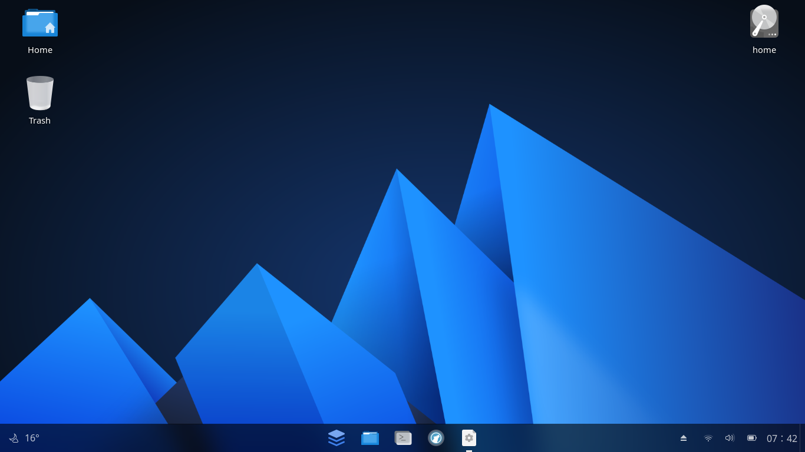
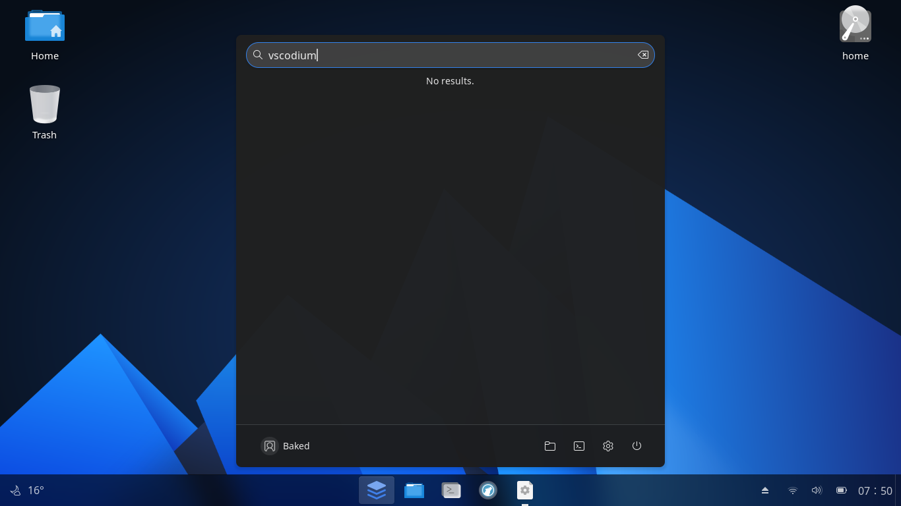

# Anduin

## Day 1
I am coming from my best desktop experience yet, so this one was quite dissapointing. First off, what is Anduin OS? It is a Debian-based distro that uses Ubuntu packages and is made to look like Windows 11. That's cool, but unfortunately, I don't care. I want my computer to be functional, not look like an operating system of which I would never stoop to it's level to use.



It all started with the installation process. I mean, where else would it have started? I was not satisfied with the experience, because I was unable to use my seperate home partition like I have with every other operating system so far. Off to a pretty poor start, I must say. Next up was installing my main packages: Git, LibreWolf, and VSCodium. Git was fine, it came preinstalled, which is something that all of the previous distros cannot say. Cool, one point to Anduin. The others, however, were not fine. I had to get snap for VSCodium, which was not simple. Unlike all of the other distros, snap was not preinstalled. I had to go out of my way to delete the anti-snap preference file, install snap, and get the snapstore. Not fun. I then proceeded to install VSCodium from the snap store, but it did not show up in the launcher menu or whatever it's called.



I have to use the command line to launch it with ```codium```, and I can't pin it to the taskbar. I could probably make a shortcut for it, which I will do now. LibreWolf was it's normal ordeal of pasting in 3 commands and waiting. Unlike Xubuntu and Ubuntu MATE, LibreWolf showed right up in the launcher. Another point for Anduin.

Alright, an update on the VSCodium shortcut: Anduin uses GNOME, and I don't think GNOME has an option for making shortcuts. Great, how convenient.

Anduin so far has been... *usable*, but I wouldn't go out of my way to choose it. It works, but there are things that work much better. It does not help that it uses GNOME, which I have had pretty bad experiences with in the past (but I don't let those past experiences sneak in to my reviews).

Great, I'm having problems now that I'm trying to push these new files to GitHub. Because I wasn't able to transfer my home partition, I have to put in my email and username again. That isn't too much of a hassle, though. How often are people really switching their OS? Definitely not every 1-3 days like I am. I also had to sign in to GitHub again, which also does not take that long, but it would have taken significantly less time if I still had my LibreWolf configuration files that had my password manager and logins saved.