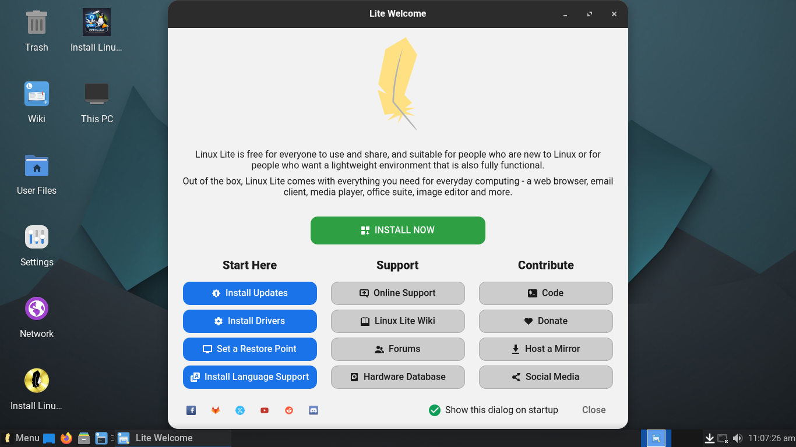
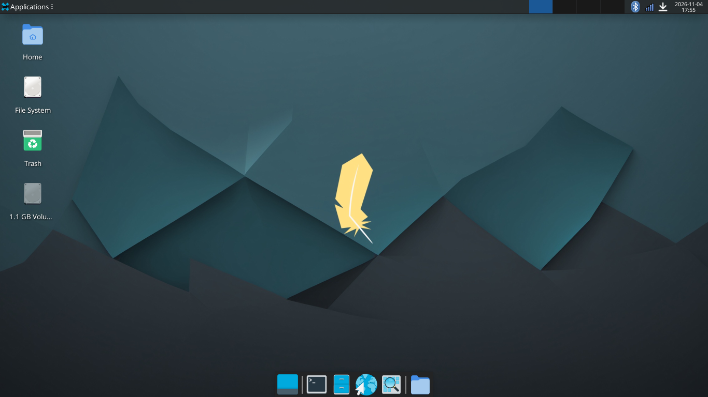
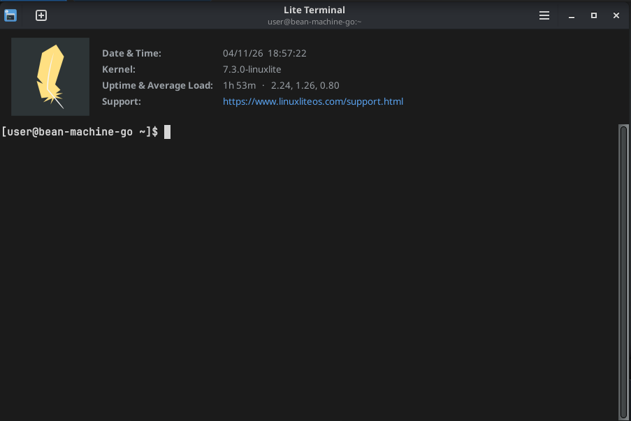
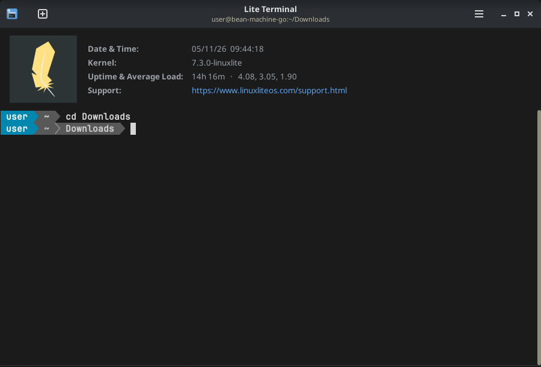
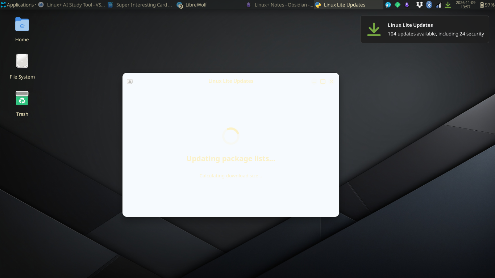
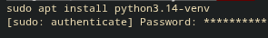

# Linux Lite

# Day 1
I took a pretty long break from these reviews, but I'm happy to be back to it! This one started out pretty fine. The only thing that made me a bit worried was the AI-generated icon on the desktop in the live environment.

It had the usual Calamares installer that let me set my current /home partition as /home in the installation which is always appreciated when switching distros, but not having a clean home directory would end up biting me in a second. The installation took a bit, but once it was done, it dropped me into... normal, boring XFCE. With none of the Linux Lite customizations that were in the live image...

It turns out that because I had a stock XFCE installation on my already existing /home partition, the Linux Lite customizations did not apply. Whatever, I just installed a Gruvbox theme and Powerline to make it look a bit nicer.

> Before Powerline...

> After Powerline

# Day 6
Oops, skipped a few days... I have only had 2 problems so far:

Some theming issues with the Gruvbox theme I downloaded,

and some battery draining issues due to AppImages stopping the computer from entering deep sleep.

One thing that I have noticed is the new Rust-based sudo implementation that shows asterisks when typing your password instead of just showing nothing.

I would say that Linux Lite is a pretty solid distro. I am comfortable with XFCE and all of the applications that it shipped with (Thundar for files, Mousepad for text editing, etc.)