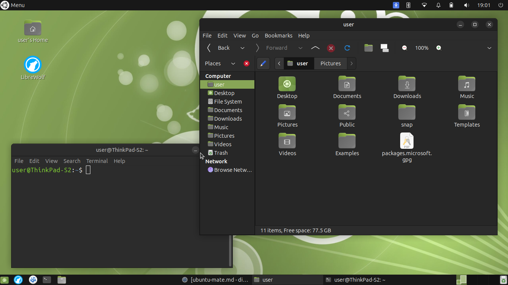

# Ubuntu MATE

## Day 1
I broke Xubuntu, so now I'm here. Xfce will be pretty difficult to top, so we'll see if MATE can do it. So far, everything that has gone wrong has been my fault, most of which was accidentally deleting most of the stuff on the top menu bar. Luckily, they must have predicted that someone like me would be messing around in their desktop environment, so they included a useful reset button. How generous. MATE has been really similar to Xfce, with slight differences in the menu styles looking more like modern GNOME and icons looking more flat. If you aren't a diehard fan of flat design but don't like the older look of Xfce, MATE is right for you.



One problem that I have is not being able to easily change the clock from 12-hour format to 24-hour. You have to use the command ```gsettings set org.gnome.desktop.interface clock-format '24h'```. I don't know why that isn't an easily accessible option, but this does just as good of a job.

I am glad that MATE does not have the same lid-closing problem that Xfce did, and that will definity put it in the lead for best DE. The only things that Xfce has going for it is the visual style (in my opinion) and the fact that it autocompletes paths and application names when creating a Launcher on the desktop.